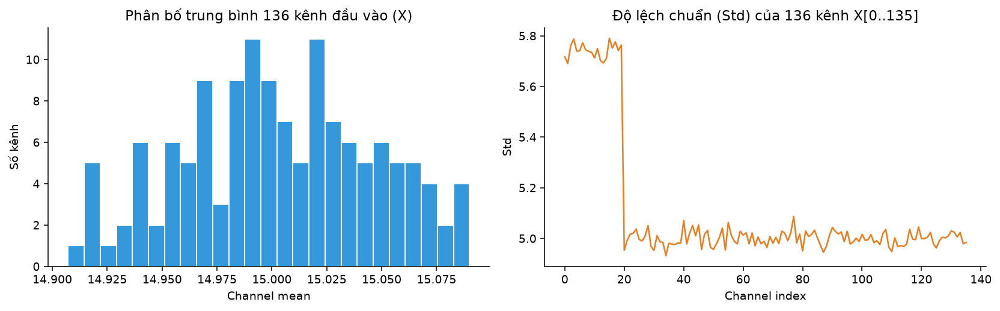
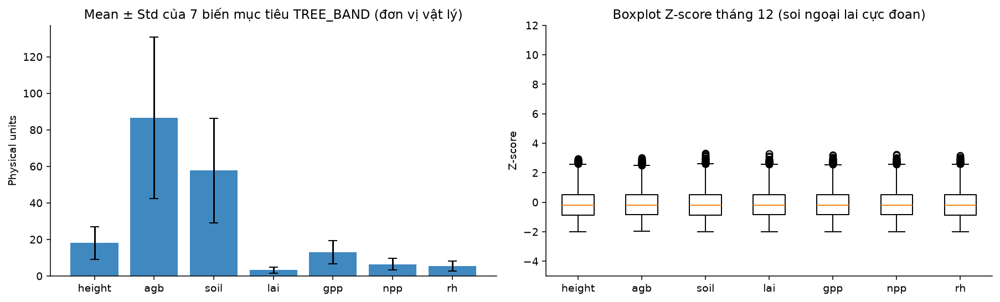
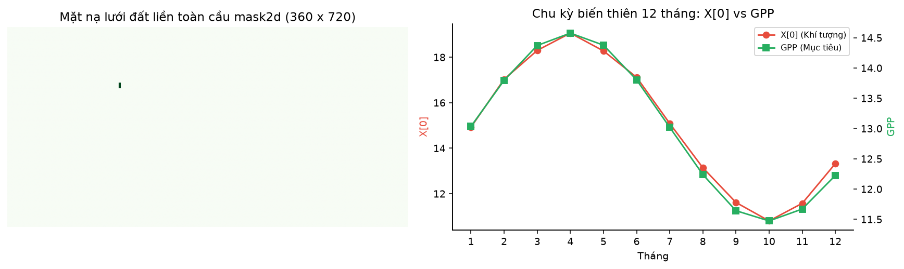
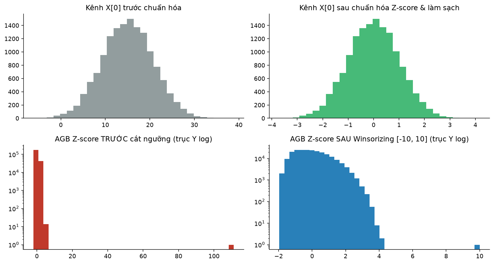
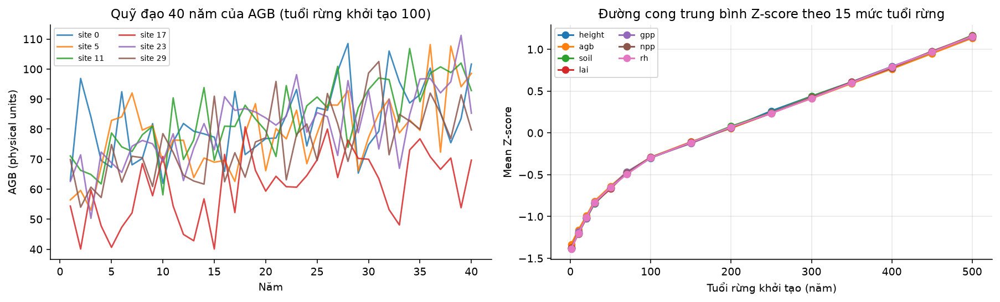
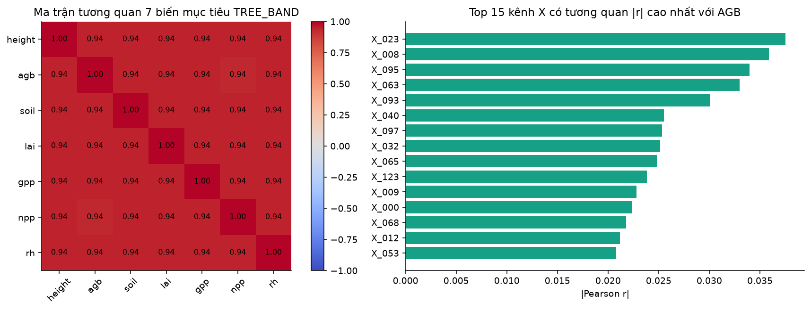

# Báo cáo Phân tích & Khám phá Dữ liệu Chuyên sâu (EDA Report)

## Mục lục
1. [Giới thiệu & Mục tiêu Báo cáo](#1-giới-thiệu--mục-tiêu-báo-cáo)
2. [Phân tích Chi tiết Từng Nhóm Biểu đồ & Tri thức Rút ra](#2-phân-tích-chi-tiết-từng-nhóm-biểu-đồ--tri-thức-rút-ra)
   - [2.1. Phân bố & Độ biến động của 136 kênh đầu vào (`X`)](#21-phân-bố--độ-biến-động-của-136-kênh-đầu-vào-x)
   - [2.2. Phân phối & Ngoại lai của 7 biến mục tiêu (`TREE_BAND`)](#22-phân-phối--ngoại-lai-của-7-biến-mục-tiêu-tree_band)
   - [2.3. Mặt nạ Không gian Toàn cầu (`mask2d`) & Chu kỳ Mùa 12 tháng](#23-mặt-nạ-không-gian-toàn-cầu-mask2d--chu-kỳ-mùa-12-tháng)
   - [2.4. Kiểm chứng Trước / Sau Chuẩn hóa & Làm sạch (`Winsorizing`)](#24-kiểm-chứng-trước--sau-chuẩn-hóa--làm-sạch-winsorizing)
   - [2.5. Quỹ đạo 40 năm & Đường cong Sinh trưởng theo 15 Tuổi rừng](#25-quỹ-đạo-40-năm--đường-cong-sinh-trưởng-theo-15-tuổi-rừng)
   - [2.6. Ma trận Tương quan Đa biến & Tương quan Tự hồi quy Bậc 1](#26-ma-trận-tương-quan-đa-biến--tương-quan-tự-hồi-quy-bậc-1)
3. [Tổng kết Tri thức Miền & Rủi ro Dữ liệu](#3-tổng-kết-tri-thức-miền--rủi-ro-dữ-liệu)
4. [Định hướng Kỹ thuật cho Tuần 3 & Tuần 4](#4-định-hướng-kỹ-thuật-cho-tuần-3--tuần-4)

---

## 1. Giới thiệu & Mục tiêu Báo cáo
Báo cáo này tổng hợp toàn bộ kết quả kiểm toán chất lượng và phân tích khám phá dữ liệu (EDA) từ hai notebook [schema_audit.ipynb](../notebooks/schema_audit.ipynb) và [eda_and_cleaning.ipynb](../notebooks/eda_and_cleaning.ipynb) trên cấu trúc mảng đa chiều **CarbonGlobe** (`.npz`/`.npy`).

Các mục tiêu trọng tâm gồm:
- Đánh giá đặc tính thống kê của **136 kênh đầu vào (`X`)** qua 40 năm $\times$ 12 tháng và **7 biến mục tiêu (`TREE_BAND`)** qua 15 mức tuổi rừng.
- Kiểm chứng hiệu quả của pipeline tiền xử lý (`src/clean.py`): tối ưu bộ nhớ `float32`, xử lý `NaN/Inf` và giới hạn ngoại lai cực đoan `[-10, 10]`.
- Rút ra tri thức miền (*domain insights*) về động lực học rừng, tính mùa vụ và tự tương quan bậc 1 để định hướng thiết kế đặc trưng và chọn mô hình ở Tuần 3–4.

---

## 2. Phân tích Chi tiết Từng Nhóm Biểu đồ & Tri thức Rút ra

### 2.1. Phân bố & Độ biến động của 136 kênh đầu vào (`X`)

* **Quan sát từ biểu đồ:**
  * 136 kênh đầu vào đại diện cho các đại lượng vật lý có đơn vị và thang đo hoàn toàn khác nhau (nhiệt độ, lượng mưa, bức xạ, nồng độ $\text{CO}_2$, thông số thổ nhưỡng).
  * Không xuất hiện kênh nào có độ lệch chuẩn bằng `0` (`std < 1e-4`), chứng tỏ không có kênh hằng số vô ích cần loại bỏ ngay ở mức cấu trúc.
* **Ý nghĩa kỹ thuật:**
  * Bắt buộc phải chuẩn hóa Z-score theo từng kênh (`x_mean`, `x_std` từ `data_stats.npz`) trước khi đưa vào các mô hình nhạy cảm thang đo (Ridge, MLP, GRU/Transformer), đồng thời dùng `eps_std = 1e-6` để phòng ngừa chia cho 0 trên dữ liệu thực tế.

### 2.2. Phân phối & Ngoại lai của 7 biến mục tiêu (`TREE_BAND`)

* **Quan sát từ biểu đồ:**
  * Các biến mục tiêu có thang đo vật lý chênh lệch rất lớn: `agb` (sinh khối trên mặt đất) và `soil` (carbon đất) có giá trị trung bình và độ lệch chuẩn lớn hơn nhiều lần so với `lai` (chỉ số diện tích lá) hay `npp`, `rh`.
  * Trên biểu đồ **Boxplot Z-score tháng 12**, phần lớn dữ liệu tập trung gọn trong khoảng `[-2, 3]`, nhưng xuất hiện điểm ngoại lai cực đoan vượt xa `+10σ` (điểm dị biệt `5000.0` cài đặt để kiểm chứng ở `agb`).
* **Tri thức miền & Quyết định xử lý:**
  * Trong sinh thái học, dữ liệu sinh khối và carbon đất có **đuôi phải dài tự nhiên** (rừng nhiệt đới lâu năm có `agb` cao gấp nhiều lần vùng đồng cỏ/bán khô hạn). Nếu cắt chặt theo $1.5\times\text{IQR}$ sẽ làm mất các điểm rừng già quan trọng.
  * Vì vậy, nhóm chọn **huấn luyện mô hình trong không gian chuẩn hóa Z-score** (để 7 biến mục tiêu có trọng số tương đương nhau trong hàm mất mát) và áp dụng **Winsorizing ở ngưỡng `[-10, 10]`** để chỉ loại bỏ nhiễu/lỗi số học cực đoan.

### 2.3. Mặt nạ Không gian Toàn cầu (`mask2d`) & Chu kỳ Mùa 12 tháng

* **Quan sát từ biểu đồ:**
  * `mask2d.npy` có kích thước `360 × 720` (độ phân giải $0.5^\circ \times 0.5^\circ$), đóng vai trò bảng tra cứu hai chiều để chiếu bất kỳ vector dự báo theo điểm lưới nào lên bản đồ thế giới qua hàm `to_global_grid()` trong `src/dataset.py`.
  * Đường cong trung bình theo 12 tháng cho thấy **tính chu kỳ mùa rõ rệt**: biến khí tượng `X[0]` đạt đỉnh vào nửa đầu năm và giảm vào nửa cuối năm, kéo theo sự dao động đồng pha của năng suất quang hợp `gpp`.
* **Ý nghĩa cho Feature Engineering (Tuần 3):**
  * Ở baseline Tuần 2 (`src/features.py`), ta lấy trung bình 12 tháng thành vector năm (`136` chiều) để khớp với giao thức chuẩn. Tuy nhiên, việc nén 12 tháng thành 1 giá trị trung bình làm mất biên độ mùa vụ (mùa hè nóng ẩm vs mùa đông khô lạnh). Ở Tuần 3, có thể bổ sung thêm `std` hoặc `min/max` theo mùa để giảm sai số `delta`.

### 2.4. Kiểm chứng Trước / Sau Chuẩn hóa & Làm sạch (`Winsorizing`)

* **Quan sát định lượng:**
  * Pipeline `clean_carbonglobe_arrays()` xử lý triệt để **100% giá trị `NaN`/`Inf`** (thay bằng kỳ vọng chuẩn hóa `0.0`), đảm bảo `remaining_nulls = 0`.
  * Trên biểu đồ histogram trục log của `agb` (hàng dưới), các điểm dị biệt cực đoan nằm ngoài `[-10, 10]` đã được đưa về biên an toàn mà không làm biến dạng hình dạng phân phối chính.
* **Kết luận:** Dữ liệu đầu ra trong `data/processed/` đạt trạng thái sạch hoàn toàn, sẵn sàng cho mọi thuật toán cây quyết định và mạng nơ-ron.

### 2.5. Quỹ đạo 40 năm & Đường cong Sinh trưởng theo 15 Tuổi rừng

* **Quan sát từ biểu đồ:**
  * **Theo trục thời gian 40 năm (trái):** Mỗi điểm lưới (`site`) có quỹ đạo tăng trưởng riêng biệt phụ thuộc vào điều kiện khí hậu/đất địa phương, nhìn chung có xu hướng tăng dần qua 4 thập kỷ.
  * **Theo 15 mức tuổi rừng khởi tạo `1 → 500` năm (phải):** Giá trị trung bình chuẩn hóa của cả 7 biến `TREE_BAND` đều tăng đơn điệu theo tuổi rừng khởi tạo, cho thấy tham số `age / 500.0` là một đặc trưng điều kiện hóa (*conditioning feature*) mang thông tin rất mạnh.
* **Ý nghĩa cho Modeling:** Mô hình bắt buộc phải giữ `age / 500.0` trong vector đầu vào `144` chiều và không được trộn lẫn các mức tuổi khi tính trạng thái khởi tạo năm 0.

### 2.6. Ma trận Tương quan Đa biến & Tương quan Tự hồi quy Bậc 1

* **Quan sát từ biểu đồ:**
  * **Tương quan chéo giữa 7 biến `TREE_BAND` (trái):** Cả 7 biến đều có tương quan dương rất mạnh với nhau (`r > 0.7`), phản ánh sự gắn kết vật lý chặt chẽ giữa chiều cao tán rừng (`height`), sinh khối (`agb`), diện tích lá (`lai`) và năng suất carbon (`gpp`, `npp`).
  * **Tương quan tự hồi quy bậc 1 (`lag-1`):** Trong `eda_and_cleaning.ipynb`, hệ số tương quan giữa trạng thái năm $t-1$ (`X_feat[:, 136:143]`) và năm $t$ (`Y_target`) đạt mức rất cao, đồng thời **Leakage Check** xác nhận dịch chuyển thời gian chính xác tuyệt đối (không rò rỉ tương lai).

---

## 3. Tổng kết Tri thức Miền & Rủi ro Dữ liệu
1. **Rủi ro trôi sai số (Autoregressive Drift):** Vì tương quan bậc 1 rất cao, mô hình học máy có xu hướng dựa mạnh vào $\mathbf{y}_{t-1}$. Khi kiểm thử **rollout 40 năm** (không có $\mathbf{y}_{t-1}$ thật mà phải dùng dự báo $\hat{\mathbf{y}}_{t-1}$ của chính mình), sai số nhỏ ở các năm đầu sẽ tích lũy dần qua 40 bước.
2. **Rủi ro bộ nhớ:** Mảng `float64` toàn cầu cần gần 29 GB RAM $\rightarrow$ đã khắc phục bằng ép kiểu `float32` (giảm 50% RAM) và hỗ trợ `max_sites` khi phát triển cục bộ.

---

## 4. Định hướng Kỹ thuật cho Tuần 3 & Tuần 4
* **Chiến lược chia tập dữ liệu (Data Splitting):** Tuyệt đối không chia ngẫu nhiên theo từng năm đơn lẻ (sẽ gây rò rỉ chuỗi 40 năm). Tuần 3 giữ nguyên chia tách theo **điểm lưới (`site`)** như tập `res_train4_test8.npz` (`3,373` train/val sites, `852` held-out test sites).
* **Lựa chọn mô hình (Model Selection):**
  * **Nhánh CPU (Tuần 3):** Huấn luyện các mô hình nền `Ridge`, `RandomForestRegressor`, `LightGBM`, `XGBoost` trên tập `144 -> 7` và đánh giá công bằng bằng **40-year autoregressive rollout** (`RMSE`, `MAE`, `R²`, `delta`, `cumulative`).
  * **Nhánh GPU miễn phí (Tuần 4 - Colab/Kaggle):** Nếu mô hình cây bị `cumulative drift` cao ở cuối chuỗi 40 năm, thử nghiệm mô hình chuỗi thời gian (`GRU` / `1D-CNN`) học trực tiếp chuỗi nhiều năm.
